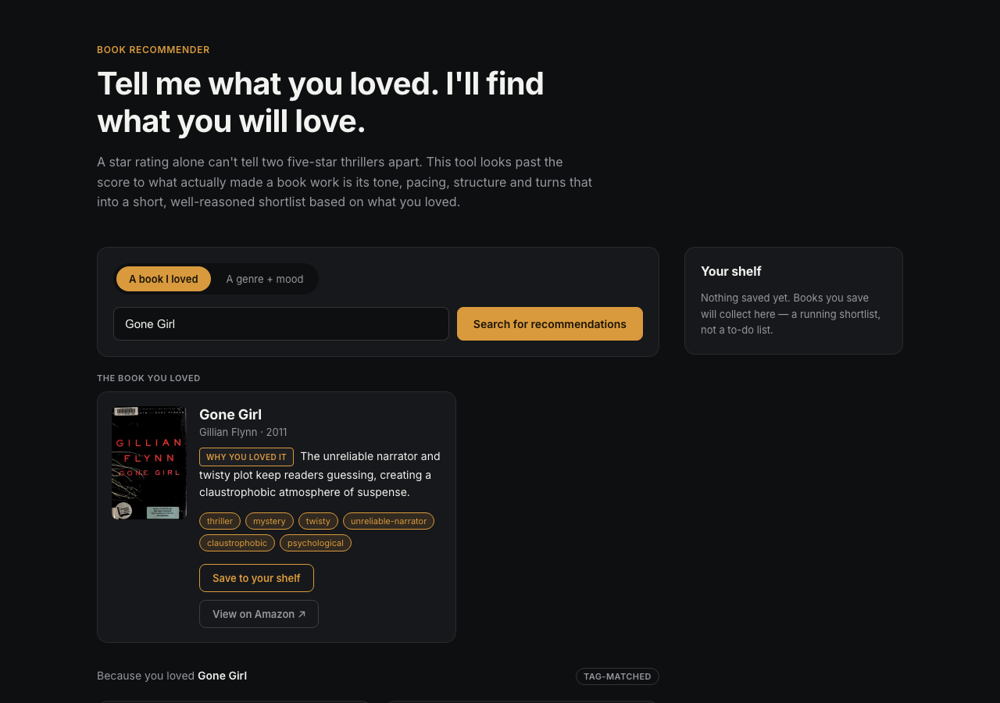

# Book Recommender

Recommends books by what actually made them work is their tone, pacing, structure instead of collapsing everything into a star rating. Tell it a book you loved, or pick a genre and mood, and it hands back a short shortlist with a real reason for each pick.



## Why

A star rating flattens everything into the same five points. Two five-star thrillers can share nothing tonally one's a slow-burn character study, the other's a plot-twist machine. This app skips the rating and matches on the qualities that actually decide whether a book will land for you.

## Features

- **Search by book** — free-text autocomplete over the catalog; get recommendations built off what made that book work.
- **Search by genre + mood** — no seed book required, just pick tags (e.g. `gothic` + `slow-burn`).
- **Every pick comes with a reason** — a one-sentence, craft-specific rationale, not a genre restatement.
- **Optional local LLM re-ranking** — when a local model is configured, recommendations are re-ordered and re-explained by the LLM for a sharper fit; the app falls back to deterministic tag-matching when it isn't.
- **Discover picks on load** — five random catalog titles shown before you've searched, so there's always something to look at.
- **Personal shelf** — save books to a running shortlist, persisted in `localStorage`.
- **Amazon lookup** — every result links out to an Amazon search for that title.

## Tech stack

| Layer    | Stack                                                              |
| -------- | ------------------------------------------------------------------- |
| Frontend | React 19, TypeScript, Vite, hand-written CSS (no UI framework)     |
| Backend  | FastAPI, Pydantic, httpx                                            |
| Data     | A curated, hand-checked catalog of 30 books (`backend/app/catalog_seed.json`) |
| LLM      | Any local model served through an OpenAI-compatible API (built and tested against [Ollama](https://ollama.com)) |

## How recommendations work

1. **Tag similarity** (`backend/app/similarity.py`) — every book is a weighted set of genre + mood tags. Candidates are scored against the seed (another book, or a genre/mood query) with a weighted Jaccard overlap; mood tags count for more than genre, since "what made it work" tends to live in tone and pacing rather than shelf category. A direct comp-title relationship gives an extra boost. This step is deterministic, has no external dependency, and always runs.
2. **Optional LLM re-rank** (`backend/app/llm_rerank.py`) — if `LOCAL_LLM_MODEL` is configured, the tag-matched shortlist is handed to a local model, which reorders it by genuine fit and writes a specific one-sentence rationale per book. If the model isn't configured, isn't reachable, or returns something unusable, the app quietly falls back to the tag-matched order and each book's stored rationale — the request never fails because of the LLM step.

## Getting started

### Prerequisites

- Node.js 20+
- Python 3.9+
- [Ollama](https://ollama.com) (optional — only needed for LLM-reasoned rationales)

### Backend

```bash
cd backend
python3 -m venv .venv
source .venv/bin/activate
pip install -r requirements.txt
uvicorn app.main:app --reload --port 8000
```

The catalog (`app/catalog_seed.json`) is already built and checked in, so this is all you need to get the API running. See [Regenerating the catalog](#regenerating-the-catalog) if you want to rebuild it.

### Frontend

```bash
cd frontend
npm install
npm run dev
```

Visit `http://localhost:5173`. The frontend expects the API at `http://localhost:8000/api` by default — see `frontend/.env.example` if you need to point it elsewhere.


## API

| Method | Path             | Description                                                        |
| ------ | ---------------- | -------------------------------------------------------------------- |
| GET    | `/api/health`        | Liveness check + catalog size                                       |
| GET    | `/api/catalog`       | All genres, moods, and titles in the catalog (powers the vibe-mode chips and autocomplete) |
| GET    | `/api/search-titles?q=` | Title autocomplete matches (max 8)                                |
| GET    | `/api/random-books?limit=` | `limit` (default 5) random catalog books, for the landing "discover" picks |
| POST   | `/api/recommend`     | Core recommendation endpoint — body: `{ seed_title? , genres? , moods? , limit? }` (one of `seed_title` or `genres`/`moods` is required) |

## Project structure

```
backend/
  app/
    main.py            FastAPI app + routes
    models.py           Pydantic request/response schemas
    similarity.py        Tag-similarity scoring
    llm_rerank.py         Optional local-LLM re-ranking
    data.py              Catalog loading + lookup helpers
    catalog_seed.json      The book catalog
  scripts/               One-time tooling used to build the catalog (see below)
frontend/
  src/
    App.tsx              Top-level state + layout
    components/          UI components (search, results grid, footer, ...)
    api.ts                Backend API client
    useSavedBooks.ts       localStorage-backed shelf
docs/
  screenshot.png
```

## Regenerating the catalog

The catalog is checked in, so this is only needed if you want to add or re-tag books.

```bash
cd backend
python3 scripts/seed_catalog.py       # fetches each title from Open Library, tags it via local LLM
python3 scripts/apply_corrections.py  # one-time manual QA fixes over the generated catalog
```

Edit `backend/scripts/book_titles.py` to change which books are included, and `backend/scripts/vocabulary.py` to change the fixed genre/mood tag vocabulary.

## Available scripts (frontend)

| Command           | Description                  |
| ------------------ | ------------------------------ |
| `npm run dev`      | Start the Vite dev server      |
| `npm run build`    | Type-check and build for production |
| `npm run lint`     | Run oxlint                     |
| `npm run preview`  | Preview the production build   |

## Contact

Built by Bhawana Yadav.

- LinkedIn: [linkedin.com/in/bhawnayadavuk](https://www.linkedin.com/in/bhawnayadavuk/)
- GitHub: [github.com/bhawnauk](https://github.com/bhawnauk)
- Email: [bhawnayadav.uk@gmail.com](mailto:bhawnayadav.uk@gmail.com)
